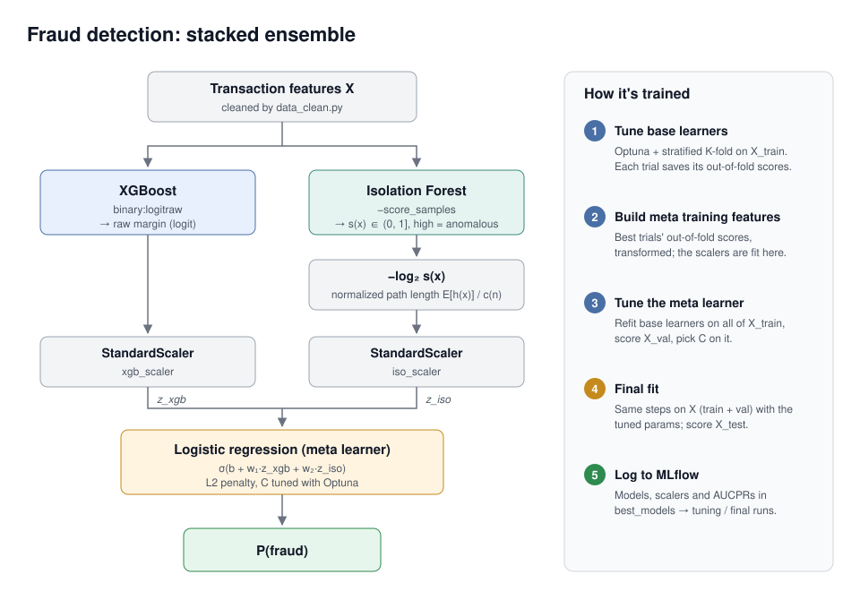

# Introduction
Recognizing fraudulent charges is an important role for credit card companies to play in order to ensure the safety of their customers and their reputation.
Here I present a credit card fraud model that labels charges as fraudulent or legitimate using a stacked ensemble. 

# Dataset
The data comes from https://www.kaggle.com/datasets/mlg-ulb/creditcardfraud. This data is the transaction data from September 2013 by European cardholders. 
The data was collected over a period of 2 days. There are 492 frauds and 284,807 total transactions, making a huge class imbalance. 

The columns include Time, 28 anonymized metrics, Amount, and Class. 

# Data Cleaning
I first began feature engineering the Time column, since the original column was just the number of seconds passed since the beginning of data collection, making 
it functionally an index. I calculated the hour of the day it must be from Time. Since hours are circular (the 23 hour goes back to 0th hour), I made sin-hour and cos-hour
columns that encoded this cyclical pattern.

Then I dropped the Time column, auxiliary columns to calculate my sin-hour and cos-hour columns, and the Class column (since that leaks the actual label).
Finally, I split the data into a 70-15-15 split of training, validation, and testing data.

# Model 
## Base Learners
My base learners were XGB gradient boosted decision trees and isolation forest. Gradient boosted decision trees make a prediction and uses trees to fit to the residuals, gradually making a better fit to the data.
The gradient boosted decision trees would perform well on supervised tabular data, with faster convergence and more accurate results than a deep learning method. Isolation forests are an unsupervised method that performs anomaly detection
by making random splits on the features. Anomalous data require less splits to become a leaf. The hope was that together, they could create a robust model where the XGB would accurately label known frauds and the isolation forest
could label "anomalous" data, which could catch unknown, unlabeled frauds.

## Meta-Learner
The meta-learner is a simple logistic regression. It would take the concatenated OOF predictions of the base learners as training features, which prevents leakage in the stack ensemble. The validation set gets put through the base learners to get
validation features. It creates a weighted vote on the base learner predictions and combines their information. 

# Training Process
I implemented a simultaneous train-and-tune stage with Optuna for hyperparameter tuning. Using mlflow to track each model's train-tune stage, I wrapped the entire 
training architecture in an Optuna study which maximized the AUCPR, my chosen metric. Once the train-tune stage was done, I did a "final training session" with the chosen hyperparameters trained on the entire training set (train + val) and tested on the true test set.
This would output the final models, and the final AUCPR scores of each individual model.

Then I wrote a dvc pipeline that connected each stage so I could make runs easy to reproduce.

The models were trained on an AWS EC2 instance with 5 stratified folds on the data, and 100 tuning runs, to ensure Optuna was able to explore a good portion of the hyperparameter space. 

# Results
The test AUCPR at the end of the final run was:

- XGB: 0.8645 
- Isolation Forest: 0.3046
- Stack (logistic regression): 0.8642 

The XGB alone performed the best, even outperforming the stack by a small amount. The most likely reason for this, which I did not realize when initially building this project, was that since all the data was labeled, the Isolation Forest was not going to add much new information
that the XGB wouldn't catch already. The main function of the Isolation Forest would be a supplementary model that would catch unseen fraud/anomalous transactions. This is good to make a robust model, since anomalous transactions should be flagged for fraud as a precaution.
However, it didn't work for the data I had since it was all labeled. In fact, it probably added extra noise since it just did worse than the pure XGB. 

# Future Considerations
I can test the Isolation Forest's capabilities by removing the labels from a portion of the training data, and seeing at what percent of labels removed does the benefits of the Isolation Forest start showing. 
A basic heuristic way to know if the Isolation side is working is if the full stack is doing better than the XGBoost. This is realistic anyways, since the transaction data is not going to come pre-labeled with fraud or not. 

# Architecture Summary
